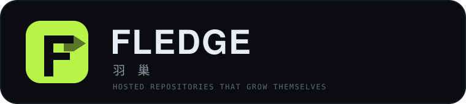
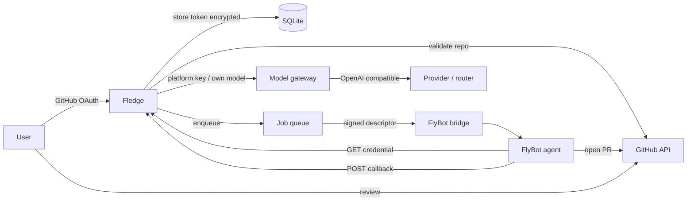

<p align="center">
  <picture>
    
  </picture>
</p>

<p align="center">
  <b>Hosted repositories that grow themselves.</b><br>
  Connect a repo. A FlyBot agent writes a failing test, makes the smallest fix, and opens one PR you can review.
</p>

<p align="center">
  <a href="https://github.com/HugoXK/fledge/actions/workflows/ci.yml"></a>
  <a href="https://github.com/HugoXK/fledge/actions/workflows/codeql.yml"></a>
  <a href="https://github.com/HugoXK/fledge/releases"></a>
  
  
  <a href="https://github.com/HugoXK/fledge/pkgs/container/fledge"></a>
</p>

<p align="center">English | <a href="README.zh.md">中文</a> · <a href="https://fledge-docs.hugoxk.online/docs/">Docs</a></p>

---

Fledge is a small, self-hosted platform for **reviewable repository growth**. A
user signs in with GitHub, connects one or more repositories with a fine-grained
token, and gives each repository a goal. Fledge hands the work to a FlyBot agent
through a signed bridge; the agent writes a failing test, makes the smallest
correct fix, opens one pull request, and reports back. Fledge never pushes to the
default branch, never merges, and never runs a user repository itself.

> **Status:** `v0.1.0` is live at <https://fledge.hugoxk.online/> with the GitHub
> token login fallback (the OAuth App is not configured yet). Documentation is at
> <https://fledge-docs.hugoxk.online/docs/>; the project homepage and guide are at
> <https://hugoxk.online/fledge/>.

## Table of contents

- [Why Fledge](#why-fledge)
- [Features](#features)
- [How it works](#how-it-works)
- [Architecture](#architecture)
- [Documentation](#documentation)
- [Quick start](#quick-start)
- [Configuration](#configuration)
- [Quota](#quota)
- [Security](#security)
- [Deployment](#deployment)
- [API](#api)
- [Development](#development)
- [Workflow](#workflow)
- [Project layout](#project-layout)
- [Roadmap](#roadmap)
- [FAQ](#faq)
- [Contributing](#contributing)
- [License](#license)
- [Acknowledgements](#acknowledgements)

## Why Fledge

Most “AI coding” tools optimize for a demo: a prompt, a diff, a video. Fledge
optimizes for the artifact a maintainer actually needs: **one focused pull
request, with a test, at a tip anyone can re-run**.

The name comes from a fledgling: a young bird that has grown its flight feathers
and leaves the nest because it is ready, not because it was pushed. A repository
in Fledge stays in your account, under your review, and gradually produces its
own improvements. See [docs/decisions/0001-name.md](docs/decisions/0001-name.md).

### What it is

- A **multi-repository** control plane for a FlyBot agent.
- A **per-user quota gateway** (1 CNY by default) with an own-model fallback.
- A **review-first** delivery loop: one PR per job, no auto-merge, full audit.

### What it is not

- Not a code runner: Fledge never clones or executes a user repository.
- Not a CI system: it uses the repository's own tests and CI.
- Not an auto-merge bot: a human (or the repository's own review gate) decides.
- Not a GitHub replacement: it is a thin, auditable layer on top of GitHub.

## Features

### Access and safety

- **GitHub OAuth login** with a pending-application gate. The first login sends a
  single-use approval email to `admin@hugoxk.online` (forwarded to the
  operator's inbox). Outgoing mail is sent from `fledge@hugoxk.online`;
  user confirmations go to the user's GitHub email.
- **Admin panel** for approve/reject, quota, user activity (last login, repos,
  jobs), audit and recent jobs. Admin-only; normal users never see it.
- **Workspace** at `/console`: an approved Fledge user gets a focused overview
  of connected repositories, active jobs and quota, with shortcuts to the full
  repository list, settings and docs. The shared Portal is linked in the footer;
  Fledge approval never grants access to other services.
- **Fork-aware onboarding**: enter the upstream repository; Fledge checks for a
  same-name fork, creates it when needed, keeps issues and PRs on the upstream,
  and pushes branches to the fork. If you own the upstream, no fork is created.
- **Reviewer role** for upstream maintainers/write members: a scheduled FlyBot
  reviewer scores every open upstream PR and posts a COMMENT review. It never
  merges or changes code.
- **Fine-grained GitHub tokens**, validated for write access on add, encrypted
  with AES-256-GCM, and only decrypted for a running job.
- **Sessions and CSRF** on every browser form; approval links are single-use and
  expire in 7 days.
- **SSRF guard** for user model URLs; public endpoints must use HTTPS.
- **Redacted logs**: no request bodies, no tokens, no full emails.

### Repositories and jobs

- **One account, many repositories.** Each repo has its own goal, cadence
  (manual, every 15 minutes to every 30 days), enabled flag and last status.
  The interval is the minimum gap between runs; it does not cap the number of
  PRs or issues the repository can produce.
- **Job lifecycle**: `queued → running → succeeded | failed | quota_exhausted`.
- **FlyBot bridge**: Fledge sends a job descriptor; the agent fetches a scoped
  GitHub credential, uses a job-scoped model token, opens a PR and calls back
  with a signature.
- **Mock runner** for local demos and tests; no network required.
- **Timeout and stale-job handling**, one active job per repo, a global cap.

### Model and quota

- **1 CNY initial platform quota** per user (`INITIAL_QUOTA_CNY`).
- OpenAI-compatible gateway at `/v1`; cost is read from
  `x-litellm-response-cost` (USD), or estimated from token usage.
- A hard **HTTP 402 `FLEDGE_QUOTA_EXHAUSTED`** with a settings link when the
  platform quota is gone, plus an in-app notification and at most one email per
  day.
- **Own model fallback**: any OpenAI-compatible Base URL / Key / Model; saving
  performs a 1-token test and bypasses the platform quota.
- A per-request `quota_ledger` and an admin-adjustable quota.

## How it works



1. The user signs in and is approved by the administrator.
2. They add a repository with a fine-grained token and a goal.
3. A manual or scheduled job is created with a job-scoped `flg_` token.
4. The FlyBot agent gets the repo token from a scoped credential URL, uses the
   model through Fledge's gateway, and opens one PR.
5. The agent posts the branch and PR URL back with the job callback secret.
6. Fledge records the result, revokes the job token, meters the cost and notifies
   the user. A human reviews the PR.

## Architecture

```
Browser ──cookie session──► Fastify (src/app.ts)
                              ├─ SQLite (src/db.ts)          users, repos, jobs, quota, audit
                              ├─ GitHub API (src/repos/)     validate tokens, PRs
                              ├─ SMTP (src/email/)           operator SMTP
                              ├─ /v1 (src/gateway/)          per-user quota / own model
                              └─ jobs (src/jobs/) ──► FlyBot bridge ──► FlyBot agent
```

Detailed design: [docs/architecture.md](docs/architecture.md) · trust boundaries:
[docs/security.md](docs/security.md) · quota semantics: [docs/quota.md](docs/quota.md).

## Documentation

The user guide and reference live at
<https://fledge-docs.hugoxk.online/docs/> (mirrored at
<https://hugoxk.online/fledge/docs/>). They are built from this repository's
`README.md` and `docs/` by [HugoXK/fledge-docs](https://github.com/HugoXK/fledge-docs).

## Quick start

Requirements: **Node 22.9+** (the app uses `node:sqlite`) and npm 10+.

```sh
git clone https://github.com/HugoXK/fledge.git
cd fledge
npm ci
cp .env.example .env

# Generate the two secrets:
node -e "console.log('SESSION_SECRET='+require('crypto').randomBytes(32).toString('base64'))"
node -e "console.log('TOKEN_ENCRYPTION_KEY='+require('crypto').randomBytes(32).toString('base64'))"

npm run dev
# http://localhost:8080
```

For a local demo without GitHub OAuth, keep `DEV_LOGIN_LOGIN=dev` in `.env` and
open <http://localhost:8080/auth/dev>. A deployed instance without an OAuth App
can use the landing page's **GitHub token login**; the token only confirms
identity and is never stored. That route is refused when
`NODE_ENV=production`; the app will not start in production if the variable is
set.

### Docker

```sh
cp .env.example .env
# fill the secrets, OAuth app, SMTP and model settings
docker compose up -d --build
```

The image is also published on a tag as
`ghcr.io/hugoxk/fledge:<version>`.

### GitHub OAuth app

Create an OAuth app at <https://github.com/settings/developers>:

- Homepage: `https://fledge.example.com` (or `http://localhost:8080`)
- Callback: `https://fledge.example.com/auth/github/callback`

Default scope: `read:user user:email`. Users still supply a per-repository
fine-grained token when they add a repo; the OAuth login never needs repo access.

### FlyBot bridge

`RUNNER_MODE=mock` (default) simulates a job without touching a repository. For
real iteration, run the bridge on the FlyBot host:

```sh
BRIDGE_TOKEN="$(openssl rand -base64 32)" \
FLYBOT_CHAT_SESSION_ID=session-... \
node bridge/flybot-bridge.mjs
```

Then set `RUNNER_MODE=flybot`, `FLYBOT_BRIDGE_URL` and `FLYBOT_BRIDGE_TOKEN` in
Fledge. See [bridge/README.md](bridge/README.md).

## Configuration

All settings are environment variables; see [.env.example](.env.example) for the
full list and comments.

| Variable | Default | Meaning |
|---|---|---|
| `BASE_URL` | `http://localhost:8080` | Public origin for OAuth, cookies and email links |
| `SESSION_SECRET` | — | Recent random secret; signs CSRF and session values |
| `TOKEN_ENCRYPTION_KEY` | — | 32-byte base64 key for AES-256-GCM |
| `GITHUB_CLIENT_ID` / `GITHUB_CLIENT_SECRET` | — | OAuth App |
| `ADMIN_GITHUB_LOGIN` | `HugoXK` | Auto-approved bootstrap admin |
| `DEV_LOGIN_LOGIN` | empty | Local demo login; must be empty in production |
| `MAIL_TRANSPORT` | `console` | `console` writes `.eml` files; `smtp` sends |
| `MAIL_FROM` / `ADMIN_EMAIL` | `fledge@hugoxk.online` / `admin@hugoxk.online` | Service sender and admin recipient (role aliases) |
| `INITIAL_QUOTA_CNY` | `1` | Initial platform budget per user |
| `USD_CNY_RATE` | `7.2` | Conversion for display and enforcement |
| `RUNNER_MODE` | `mock` | `mock` or `flybot` |
| `ALLOW_PRIVATE_MODEL_URLS` | `false` | Allow loopback model URLs in development |

Production startup fails closed when the session/encryption keys, OAuth app (or
`ALLOW_TOKEN_LOGIN_ONLY=true`) or SMTP password are missing.

## Quota

- New users start with **1 CNY**.
- The gateway records the real cost from `x-litellm-response-cost` (USD) or
  estimates it from token usage.
- Remaining = `quota_cny - used_usd * USD_CNY_RATE`.
- At zero: HTTP 402, `code: FLEDGE_QUOTA_EXHAUSTED`, a settings link, an in-app
  notice, and at most one email per day.
- If the user configured their own model, the gateway proxies to it and does not
  touch the platform quota.

The full rules, edge cases and the 402 body are in [docs/quota.md](docs/quota.md).

## Security

- AES-256-GCM at rest for GitHub tokens and user model keys.
- HttpOnly/SameSite sessions; CSRF on every form; single-use approval links.
- SSRF checks on user model URLs; public endpoints must use HTTPS.
- `flg_` tokens are hashed, scoped and revocable; job tokens are revoked when the
  job finishes or times out.
- Logs are redacted; request bodies are never logged.
- Security headers (CSP, nosniff, frame deny, HSTS in production).
- No admin merge, no bypass of a required check, no auto-merge of user PRs.

Report a vulnerability privately: see [SECURITY.md](SECURITY.md). The full model
is in [docs/security.md](docs/security.md).

## Deployment

- [docs/deploy.md](docs/deploy.md) — OAuth, SMTP, nginx, systemd, Docker, backup.
- [deploy/](deploy/) — systemd unit and nginx sample.
- `npm run db:backup` — online SQLite backup (safe while serving).
- The service is single-writer SQLite; run one instance per database.
- The FlyBot bridge listens on loopback and should never be public.

## API

- Browser routes and the job credential/callback endpoints:
  [docs/api.md](docs/api.md).
- Model gateway: OpenAI-compatible at `${BASE_URL}/v1`; authenticate with a
  `flg_` token. Example:

```sh
curl http://localhost:8080/v1/chat/completions \
  -H "Authorization: Bearer flg_…" \
  -H "Content-Type: application/json" \
  -d '{"model":"your-model","messages":[{"role":"user","content":"hi"}],"max_tokens":64}'
```

## Development

```sh
npm run check        # lint + typecheck + tests + build
npm test             # 7 node:test suites with fake GitHub/model/SMTP
npm run dev          # watch mode
npm run db:backup
```

The tests use an in-memory SQLite database and local fake servers; no network is
required. CI runs the same commands on Node 22 and 24, builds the Docker image,
audits production dependencies, checks changelog fragments and computes the risk
tier. The required aggregate check is **`ci-ok`**.

### Project layout

| Path | What it is |
|---|---|
| `src/app.ts`, `src/index.ts` | Fastify app, routes, bootstrap |
| `src/config.ts`, `src/db.ts` | Environment loading, SQLite schema/store |
| `src/auth/`, `src/users/` | OAuth, sessions, approvals |
| `src/repos/` | GitHub API client, token validation |
| `src/jobs/` | Job queue, mock/FlyBot runners |
| `src/gateway/` | Model gateway, quota, SSRF guard |
| `src/email/` | Console/SMTP mailer, templates |
| `src/views/`, `public/` | Server-rendered UI and assets |
| `bridge/` | Bridge for the FlyBot host |
| `test/` | Unit and integration tests |
| `deploy/` | systemd and nginx samples |
| `docs/` | Architecture, API, deploy, quota, security, workflow |

## Workflow

Fledge is developed with the pipeline it describes:

```
issue → claim → worktree → red test → fix → gates → PR
      → review at the tip → risk tier → merge queue → release
```

- [AGENTS.md](AGENTS.md) — the binding pipeline, tiers, labels and hard rules.
- [LESSONS.md](LESSONS.md) — dated lessons; promote after 3 days.
- [docs/code-standards.md](docs/code-standards.md) — Verifier honesty, review
  format, merge rules.
- [docs/autonomous-dev.md](docs/autonomous-dev.md) — maintenance, claims, release.

The tier is computed from the diff (`node scripts/risk-gate.mjs --base
origin/main`), never from a label. T0/T1 merge on green `ci-ok`; T2/T3 need a
PASS at the same tip, with a real `Ran:` command.

## Roadmap

| Version | Focus |
|---|---|
| `v0.1` | OAuth + approval mail, multi-repo, encrypted tokens, quota gateway, own model, mock/FlyBot runners, admin/audit |
| `v0.2` | GitHub App installation, PR feedback loop (red CI/review → follow-up job), job cancellation, path guards |
| `v0.3` | Per-repo budgets, team roles, model routing, usage export |
| `v1.0` | Postgres, worker pool, tracing/metrics, backup restore drill, external security review |

Full list and open questions: [docs/roadmap.md](docs/roadmap.md).

## FAQ

**Does Fledge push to my default branch?**
No. A job creates a branch and one pull request. Fledge never pushes `main` and
never merges.

**Where is my GitHub token stored?**
Encrypted with AES-256-GCM using `TOKEN_ENCRYPTION_KEY`; it is decrypted only for
a running job and never rendered back.

**What happens when the 1 CNY quota is gone?**
The gateway returns HTTP 402 and the UI asks you to add your own model API. Jobs
stop using the platform key; they continue on your key once configured.

**Is the platform itself open source?**
Yes, Apache-2.0. The hosted instance at `fledge.hugoxk.online` is the same code
with the operator's OAuth app and bridge.

**Can I self-host it?**
Yes. Docker or `npm start`, a GitHub OAuth app, SMTP, and a FlyBot bridge. See
[docs/deploy.md](docs/deploy.md).

**Does it support GitLab?**
Not in v0.1. The GitHub client is isolated in `src/repos/`; a second provider is
a roadmap item.

**Why `node:sqlite`?**
It removes a native build dependency for a small self-hosted service. The
wrapper is one file (`src/db.ts`), so a move to Postgres is local.

## Contributing

Contributions are welcome when they follow [CONTRIBUTING.md](CONTRIBUTING.md),
[AGENTS.md](AGENTS.md) and [docs/code-standards.md](docs/code-standards.md).

- One issue, one branch, one PR. If an issue already has a PR, push there.
- Add a failing test first; list what you ran and did not run.
- Never commit secrets. Never open a public issue with exploit detail.
- User-facing UI text is bilingual Chinese/English; keep both translations and the two READMEs in step.

## License

[Apache-2.0](LICENSE). By contributing you agree that your contribution is
licensed under the same terms (section 5 of the licence).

## Built with

[Fastify](https://fastify.dev/), SQLite, the GitHub API, and
[FlyBot](https://github.com/ThinkFlowLab/FlyBot) as the agent runtime.

---

<p align="center"><sub>Fledge / 羽巢 · hosted repositories that grow themselves · <a href="https://hugoxk.online/fledge/">hugoxk.online/fledge</a></sub></p>
