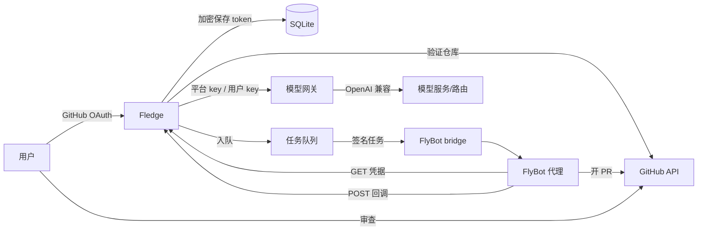

<p align="center">
  <picture>
    
  </picture>
</p>

<p align="center">
  <b>让仓库自己长大。</b><br>
  接入一个仓库。FlyBot 先写失败测试，再做最小修复，最后开一个你可以审查的 PR。
</p>

<p align="center">
  <a href="https://github.com/HugoXK/fledge/actions/workflows/ci.yml"></a>
  <a href="https://github.com/HugoXK/fledge/actions/workflows/codeql.yml"></a>
  <a href="https://github.com/HugoXK/fledge/releases"></a>
  
  
  <a href="https://github.com/HugoXK/fledge/pkgs/container/fledge"></a>
</p>

<p align="center"><a href="README.md">English</a> | 中文 · <a href="https://fledge-docs.hugoxk.online/docs/">文档</a></p>

---

Fledge 是一个自托管的小平台，做的是**可审查的仓库成长**。用户用 GitHub 登录，
用 fine-grained token 接入一个或多个仓库，给每个仓库一个目标。Fledge 通过签名
bridge 把任务交给 FlyBot 代理；代理先写失败测试，做最小修复，开一个 PR，再回调
平台。Fledge 不会推默认分支、不会自动合并、也不会在本地执行用户仓库。

> **状态：** `v0.1.0` 已上线：<https://fledge.hugoxk.online/>，当前使用 GitHub
> token 登录（OAuth App 尚未配置）。文档在
> <https://fledge-docs.hugoxk.online/docs/>；项目主页和 Guide 在
> <https://hugoxk.online/fledge/>。

## 目录

- [为什么叫 Fledge](#为什么叫-fledge)
- [功能](#功能)
- [工作方式](#工作方式)
- [架构](#架构)
- [文档](#文档)
- [快速开始](#快速开始)
- [配置](#配置)
- [额度](#额度)
- [安全](#安全)
- [部署](#部署)
- [API](#api)
- [开发](#开发)
- [工作流](#工作流)
- [项目结构](#项目结构)
- [路线图](#路线图)
- [FAQ](#faq)
- [贡献](#贡献)
- [许可证](#许可证)
- [致谢](#致谢)

## 为什么叫 Fledge

大多数「AI 写代码」工具优化的是演示：一个 prompt、一个 diff、一段视频。Fledge
优化的是维护者真正需要的东西：**一个聚焦的 PR，带测试，tip 可以被任何人重跑**。

Fledge 是幼鸟长齐飞羽、离巢试飞的那一刻——不是因为被推下去，而是因为准备好了。
仓库留在你的账号里、在你的审查之下，逐步产出自己的改进。取名过程见
[docs/decisions/0001-name.md](docs/decisions/0001-name.md)。

### 它是什么

- FlyBot 代理的**多仓库控制面**。
- 按用户计量的**额度网关**（默认 1 元），用完可以接自己的模型。
- **审查优先**的交付闭环：一个任务一个 PR，不自动合并，全程审计。

### 它不是什么

- 不是代码执行器：Fledge 不 clone、不运行用户仓库。
- 不是 CI：它使用仓库自己的测试和 CI。
- 不是自动合并机器人：最终由人或仓库自己的 review gate 决定。
- 不是 GitHub 替代品：它是 GitHub 之上薄薄的一层。

## 功能

### 访问与安全

- **GitHub OAuth 登录 + 待审批**：首次登录给管理员
  `flybot@yeah.net` → `hugo2001xk@gmail.com` 发一封一次性批准邮件。
- **Admin 面板**：批准/拒绝、改额度、审计、最近任务。
- **fine-grained GitHub token**：添加时验证写权限，AES-256-GCM 加密保存，
  只在任务运行时解密。
- **Session + CSRF**：所有表单都有 CSRF；审批链接一次性、7 天过期。
- **SSRF 防护**：用户模型 URL 做 HTTPS/内网检查。
- **日志脱敏**：不记录请求体、token、完整邮件。

### 仓库与任务

- **一个账号多个仓库**：每个仓库有独立目标、节奏（手动/每小时/每天/每周）、
  启用状态和上次状态。
- **任务状态**：`queued → running → succeeded | failed | quota_exhausted`。
- **FlyBot bridge**：Fledge 发任务描述；代理从一次性凭据 URL 取 GitHub token，
  用任务级模型 token 调模型，开 PR，再签名回调。
- **Mock runner**：本地演示和测试不需要网络。
- **超时/陈旧任务处理**：一个仓库同时只跑一个任务，全局有并发上限。

### 模型与额度

- 新用户初始 **1 元**平台额度（`INITIAL_QUOTA_CNY`）。
- OpenAI 兼容网关 `/v1`；成本优先读 `x-litellm-response-cost`（USD），没有才按
  token 估算。
- 额度用完返回 **HTTP 402 `FLEDGE_QUOTA_EXHAUSTED`**，带设置链接；站内通知 +
  每天最多一封邮件。
- **自带模型**：任意 OpenAI 兼容 Base URL / Key / Model；保存时发 1 token 测试，
  之后不再扣平台额度。
- 每个平台代付请求写一条 `quota_ledger`；Admin 可调额度。

## 工作方式



1. 用户登录，管理员批准。
2. 用 fine-grained token 添加仓库，写目标。
3. 手动或定时创建任务，带任务级 `flg_` token。
4. FlyBot 代理从凭据 URL 取仓库 token，通过 Fledge 网关调模型，开一个 PR。
5. 代理用任务回调密钥把分支和 PR URL 报回。
6. Fledge 记录结果、撤销任务 token、计量成本、通知用户；人来审查 PR。

## 架构

```
浏览器 ──cookie session──► Fastify (src/app.ts)
                            ├─ SQLite (src/db.ts)        users/repos/jobs/quota/audit
                            ├─ GitHub API (src/repos/)   验证 token、开 PR
                            ├─ SMTP (src/email/)         flybot@yeah.net
                            ├─ /v1 (src/gateway/)        按用户额度 / 自带模型
                            └─ jobs (src/jobs/) ──► FlyBot bridge ──► FlyBot 代理
```

细节见 [docs/architecture.md](docs/architecture.md)、信任边界见
[docs/security.md](docs/security.md)、额度口径见 [docs/quota.md](docs/quota.md)。

## 文档

用户 Guide 和参考在 <https://fledge-docs.hugoxk.online/docs/>（镜像：
<https://hugoxk.online/fledge/docs/>）。它们由
[HugoXK/fledge-docs](https://github.com/HugoXK/fledge-docs) 从本仓库的
`README.md` 和 `docs/` 自动构建。

## 快速开始

要求 **Node 22.9+**（需要 `node:sqlite`）和 npm 10+。

```sh
git clone https://github.com/HugoXK/fledge.git
cd fledge
npm ci
cp .env.example .env

# 生成两个密钥
node -e "console.log('SESSION_SECRET='+require('crypto').randomBytes(32).toString('base64'))"
node -e "console.log('TOKEN_ENCRYPTION_KEY='+require('crypto').randomBytes(32).toString('base64'))"

npm run dev
# http://localhost:8080
```

本地没有 GitHub OAuth 时，保留 `.env` 里的 `DEV_LOGIN_LOGIN=dev`，直接打开
<http://localhost:8080/auth/dev>。已部署但暂时没有 OAuth App 的实例，可以用首页的
**GitHub token 登录**；token 只用于确认身份，不会保存。`NODE_ENV=production` 时该入口被拒绝，且设置了
这个变量会拒绝启动。

### Docker

```sh
cp .env.example .env
# 填密钥、OAuth App、SMTP、模型
docker compose up -d --build
```

发布 tag 时镜像也会推到 `ghcr.io/hugoxk/fledge:<version>`。

### GitHub OAuth App

在 <https://github.com/settings/developers> 新建 OAuth App：

- Homepage: `https://fledge.example.com`（或 `http://localhost:8080`）
- Callback: `https://fledge.example.com/auth/github/callback`

默认 scope：`read:user user:email repo`。用户加仓库时仍要单独提供 fine-grained token。

### FlyBot bridge

`RUNNER_MODE=mock`（默认）只模拟任务。真实自迭代在 FlyBot 主机上跑 bridge：

```sh
BRIDGE_TOKEN="$(openssl rand -base64 32)" \
FLYBOT_CHAT_SESSION_ID=session-... \
node bridge/flybot-bridge.mjs
```

然后在 Fledge 里设 `RUNNER_MODE=flybot`、`FLYBOT_BRIDGE_URL`、
`FLYBOT_BRIDGE_TOKEN`。详见 [bridge/README.md](bridge/README.md)。

## 配置

全部通过环境变量；完整列表和注释见 [.env.example](.env.example)。

| 变量 | 默认 | 作用 |
|---|---|---|
| `BASE_URL` | `http://localhost:8080` | OAuth、cookie、邮件链接的公网 origin |
| `SESSION_SECRET` | — | 随机密钥，签 CSRF/session 派生值 |
| `TOKEN_ENCRYPTION_KEY` | — | 32 字节 base64，AES-256-GCM |
| `GITHUB_CLIENT_ID` / `GITHUB_CLIENT_SECRET` | — | OAuth App |
| `ADMIN_GITHUB_LOGIN` | `HugoXK` | 自动批准的 bootstrap 管理员 |
| `DEV_LOGIN_LOGIN` | 空 | 本地演示登录；生产必须为空 |
| `MAIL_TRANSPORT` | `console` | `console` 写 `.eml`；`smtp` 真发 |
| `MAIL_FROM` / `ADMIN_EMAIL` | `flybot@yeah.net` / `hugo2001xk@gmail.com` | 审批邮件 |
| `PLATFORM_LLM_BASE_URL` | `http://127.0.0.1:8081/v1` | OpenAI 兼容端点 |
| `PLATFORM_LLM_KEY` | — | 平台代付 key |
| `INITIAL_QUOTA_CNY` | `1` | 每用户初始额度 |
| `USD_CNY_RATE` | `7.2` | 展示与执行换算 |
| `RUNNER_MODE` | `mock` | `mock` 或 `flybot` |
| `ALLOW_PRIVATE_MODEL_URLS` | `false` | 开发时允许 loopback 模型 URL |

生产模式缺 session/加密 key、OAuth App（或显式 `ALLOW_TOKEN_LOGIN_ONLY=true`）或
SMTP 密码会拒绝启动。

## 额度

- 新用户初始 **1 元**。
- 网关优先读 `x-litellm-response-cost`（USD），没有才按 token 估。
- 剩余 = `quota_cny - used_usd * USD_CNY_RATE`。
- 归零：HTTP 402、`code: FLEDGE_QUOTA_EXHAUSTED`、设置链接、站内通知、每天最多
  一封邮件。
- 用户配置了自己的模型后，网关直接代理，不再扣平台额度。

完整规则、边界和 402 body 见 [docs/quota.md](docs/quota.md)。

## 安全

- GitHub token、用户模型 key 用 AES-256-GCM 加密落盘。
- Session 是 HttpOnly/SameSite；所有表单有 CSRF；审批链接一次性。
- 用户模型 URL 做 SSRF 检查；公网必须 HTTPS。
- `flg_` token 哈希保存、可撤销；任务结束/超时撤销任务 token。
- 日志脱敏；不记录请求体。
- 安全头（CSP、nosniff、frame deny、生产 HSTS）。
- 不 admin-merge、不绕 required check、不自动合并用户 PR。

漏洞请私信，见 [SECURITY.md](SECURITY.md)；完整模型见 [docs/security.md](docs/security.md)。

## 部署

- [docs/deploy.md](docs/deploy.md)：OAuth、SMTP、nginx、systemd、Docker、备份。
- [deploy/](deploy/)：systemd unit 和 nginx 样例。
- `npm run db:backup`：在线 SQLite 备份。
- SQLite 单写；一个数据库只跑一个实例。
- FlyBot bridge 只监听 loopback，不要公开。

## API

- 浏览器路由、任务凭据/回调：[docs/api.md](docs/api.md)。
- 模型网关：`${BASE_URL}/v1`，用 `flg_` token 认证。示例：

```sh
curl http://localhost:8080/v1/chat/completions \
  -H "Authorization: Bearer flg_…" \
  -H "Content-Type: application/json" \
  -d '{"model":"DeepSeek-V4.1-Flash-1017","messages":[{"role":"user","content":"hi"}],"max_tokens":64}'
```

## 开发

```sh
npm run check        # lint + typecheck + tests + build
npm test             # 7 个 node:test 套件，假 GitHub/模型/SMTP
npm run dev          # watch
npm run db:backup
```

测试用内存 SQLite 和本地假服务，不需要网络。CI 在 Node 22/24 跑同样的命令，
并构建 Docker、审计生产依赖、检查 changelog fragment、计算风险等级。聚合
required check 是 **`ci-ok`**。

### 项目结构

| 路径 | 作用 |
|---|---|
| `src/app.ts`, `src/index.ts` | Fastify 路由、启动 |
| `src/config.ts`, `src/db.ts` | 环境变量、SQLite schema/Store |
| `src/auth/`, `src/users/` | OAuth、session、审批 |
| `src/repos/` | GitHub API、token 校验 |
| `src/jobs/` | 任务队列、Mock/FlyBot runner |
| `src/gateway/` | 模型网关、额度、SSRF |
| `src/email/` | Console/SMTP mailer、模板 |
| `src/views/`, `public/` | 服务端 UI、静态资源 |
| `bridge/` | FlyBot 主机上的 bridge |
| `test/` | 单元/集成测试 |
| `deploy/` | systemd、nginx 样例 |
| `docs/` | 架构、API、部署、额度、安全、工作流 |

## 工作流

Fledge 用自己描述的流水线开发：

```
issue → claim → worktree → 红测试 → 修 → gates → PR
      → tip 评审 → 风险分级 → merge queue → release
```

- [AGENTS.md](AGENTS.md)：约束、流程、风险分级、标签、硬规则。
- [LESSONS.md](LESSONS.md)：日期化教训，≥3 天 promote。
- [docs/code-standards.md](docs/code-standards.md)：Verifier 诚实、评审格式、合并规则。
- [docs/autonomous-dev.md](docs/autonomous-dev.md)：维护、claim、release。

风险等级从 diff 计算（`node scripts/risk-gate.mjs --base origin/main`），
不看标签。T0/T1 绿 `ci-ok` 即入队；T2/T3 需要同一 tip 的 PASS，且必须有真
`Ran:` 命令。

## 路线图

| 版本 | 重点 |
|---|---|
| `v0.1` | OAuth + 审批邮件、多仓库、加密 token、额度网关、自带模型、Mock/FlyBot runner、Admin/审计 |
| `v0.2` | GitHub App、PR 反馈闭环（红 CI/review → 追加任务）、任务取消、路径守卫 |
| `v0.3` | 按仓库预算、团队角色、模型路由、用量导出 |
| `v1.0` | Postgres、worker pool、tracing/metrics、备份恢复演练、外部安全评审 |

完整列表和开放问题见 [docs/roadmap.md](docs/roadmap.md)。

## FAQ

**会直接推默认分支吗？**
不会。任务只创建分支和一个 PR；Fledge 不推 `main`，不合并。

**GitHub token 存在哪？**
AES-256-GCM 加密，密钥是 `TOKEN_ENCRYPTION_KEY`；只在任务运行时解密，页面不回显。

**1 元额度用完了怎么办？**
网关返回 402，UI 提示你配置自己的模型 API；配置后任务继续跑，不再扣平台额度。

**平台本身开源吗？**
是，Apache-2.0。`fledge.hugoxk.online` 是同一份代码 + 运维方的 OAuth App 和 bridge。

**能自托管吗？**
能。Docker 或 `npm start` + GitHub OAuth App + SMTP + FlyBot bridge，见
[docs/deploy.md](docs/deploy.md)。

**支持 GitLab 吗？**
v0.1 不支持。GitHub 客户端隔离在 `src/repos/`，第二个 provider 在路线图上。

**为什么用 `node:sqlite`？**
避免小服务引入原生构建依赖。封装只有 `src/db.ts` 一个文件，以后换 Postgres 很局部。

## 贡献

欢迎贡献，但请遵守 [CONTRIBUTING.md](CONTRIBUTING.md)、[AGENTS.md](AGENTS.md) 和
[docs/code-standards.md](docs/code-standards.md)。

- 一个 issue 一个分支一个 PR；已有 PR 就推到那个分支。
- 先写失败测试；报告你跑了什么、没跑什么。
- 不提交密钥；不在公开 issue 里贴漏洞细节。
- 用户可见 UI 是中文；英文和中文 README 保持同步。

## 许可证

[Apache-2.0](LICENSE)。提交贡献即同意按同样条款授权（许可证第 5 节）。

## 构建于

[Fastify](https://fastify.dev/)、SQLite、GitHub API，以及
[FlyBot](https://github.com/ThinkFlowLab/FlyBot) 作为代理运行时。

---

<p align="center"><sub>Fledge / 羽巢 · 让仓库自己长大 · <a href="https://hugoxk.online/fledge/">hugoxk.online/fledge</a></sub></p>
